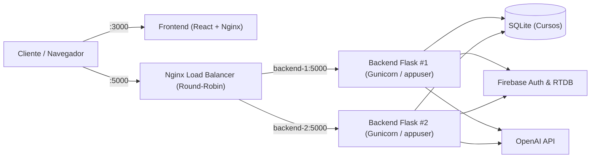

# CourseSphere — Desafio Técnico AppSec & SRE (Segurança e Confiabilidade)

O **CourseSphere** é uma aplicação web de recomendação e consulta acadêmica de cursos construída com **React (TypeScript + Vite)** no frontend e **Python (Flask + SQLite + Firebase Admin + OpenAI)** no backend.

Este repositório contém a entrega completa do **Desafio Técnico de Segurança de Aplicações (AppSec) e Site Reliability Engineering (SRE)**, abrangendo análise de vulnerabilidades, evidências SAST/SCA/DAST, correção de causas raízes, *hardening*, instrumentação de observabilidade (logs estruturados em JSON + métricas Prometheus), testes automatizados, pipeline CI/CD DevSecOps e escalabilidade horizontal com Docker Compose e Nginx Load Balancer.

---

## 📄 Documentação Principal e Evidências

* 📘 **[Relatório Técnico Completo (Pentest + Threat Modeling STRIDE + SRE)](./RELATORIO_TECNICO_APPSEC_SRE.md):** Escopo, metodologia, modelo de ameaças STRIDE, análise detalhada das 7 vulnerabilidades (CVSS, causa raiz e correções), SLIs/SLOs e arquitetura de confiabilidade.
* 🗂️ **[Índice Geral de Evidências (SAST, SCA, Burp Suite e Load Balancer)](./docs/evidencias/INDICE_EVIDENCIAS.md):** Mapeamento de todos os relatórios estáticos (`bandit.txt`, `bandit-pos-correcao.txt`, `eslint-security.txt`, `npm-audit`, `pip-audit`), capturas visuais do *Burp Suite Community* e logs do balanceador de carga.
* ⚙️ **[Pipeline CI/CD DevSecOps (GitHub Actions)](./.github/workflows/secops-ci.yml):** Automação de SAST, SCA e suíte de testes de segurança a cada `push` / `pull_request`.

---

## 🏗️ Arquitetura da Solução (Docker + Nginx Load Balancer)



---

## 🚀 Como Subir e Acessar o Sistema via Docker (Recomendado)

A orquestração via `docker-compose.yml` sobe automaticamente **2 réplicas do backend** (`backend-1` e `backend-2`), o **balanceador de carga Nginx** (`nginx-lb`) e o **frontend React**.

### 1. Configurar variáveis de ambiente (Opcional)
Copie o arquivo `.env.example` caso deseje fornecer suas chaves do Firebase/OpenAI (para rotas de cursos, healthcheck, métricas e testes de segurança, nenhuma chave externa é obrigatória):
```bash
cp .env.example .env
```

### 2. Construir e iniciar os containers
```bash
docker compose up --build -d
```

### 3. Acessar os serviços
* **Frontend Web:** `http://localhost:3000`
* **API Backend (via Nginx Load Balancer):** `http://localhost:5000`
* **Endpoint de Saúde (`/health`):** `http://localhost:5000/health`
* **Métricas Prometheus (`/metrics`):** `http://localhost:5000/metrics`
* **Catálogo de Cursos (`/courses`):** `http://localhost:5000/courses`

### 4. Comprovar o Balanceamento de Carga entre as 2 Instâncias
Execute 6 requisições consecutivas para o balanceador Nginx na porta `5000`:
```bash
for i in {1..6}; do curl -s http://127.0.0.1:5000/health; echo ""; done
```
Você verá o campo `"instance_id"` alternando em *round-robin* entre `"backend-1"` e `"backend-2"`. Para inspecionar os logs do balanceador Nginx:
```bash
docker logs coursesphere-nginx-lb
```

---

## 💻 Como Rodar Localmente (Sem Docker)

### Backend (Python + Flask)
```bash
cd backend
python3 -m venv ambiente
source ambiente/bin/activate
pip install -r requirements.txt
python endpoints.py
```
O servidor iniciará em `http://127.0.0.1:5000` (com `FLASK_DEBUG=false` por padrão).

### Frontend (React + Vite)
```bash
cd frontend
npm install
npm run dev
```
A interface ficará disponível em `http://localhost:5173`.

---

## 🔍 Como Executar as Ferramentas de Segurança (SAST, SCA e Testes Automatizados)

### 1. Rodar a Suíte de Testes Automatizados de Segurança e SRE (7 testes)
```bash
cd backend
./ambiente/bin/python -m unittest discover -s tests -v
```
*(Valida prevenção de SQL Injection, bloqueio de acesso não autenticado, rejeição de JWT na URL, allowlist de CORS, headers de segurança HTTP, sanitização XSS/Path Traversal, Rate Limiting HTTP 429 e endpoints `/health` e `/metrics`).*

### 2. Análise Estática (SAST) — Backend (Bandit)
```bash
cd backend
./ambiente/bin/bandit -c bandit.yaml -r .
```
* **Estado Inicial (Vulnerável):** 20 problemas reportados (salvo em [`docs/evidencias/bandit.txt`](./docs/evidencias/bandit.txt)).
* **Estado Atual (Corrigido):** `No issues identified` (salvo em [`docs/evidencias/bandit-pos-correcao.txt`](./docs/evidencias/bandit-pos-correcao.txt)).

### 3. Análise de Dependências (SCA) — Backend (`pip-audit`)
```bash
cd backend
./ambiente/bin/pip-audit
```

### 4. Análise Estática (SAST) e Dependências (SCA) — Frontend (`ESLint Security` & `npm audit`)
```bash
cd frontend
npx eslint src/components/DeckOfCards/CardDeck.tsx src/pages/signup/SignUp.tsx
npm audit
```

---

## 🧪 Como Reproduzir os Achados de Segurança

Todos os passos de reprodução (antes e depois das correções), payloads utilizados e capturas do **Burp Suite Community** estão detalhados em:
1. **[Relatório Técnico — Seção 4 (Análise Detalhada das Vulnerabilidades)](./RELATORIO_TECNICO_APPSEC_SRE.md#4-análise-detalhada-das-vulnerabilidades-e-correções-aplicadas)**
2. **[Índice de Evidências e Requisições HTTP](./docs/evidencias/INDICE_EVIDENCIAS.md)**
