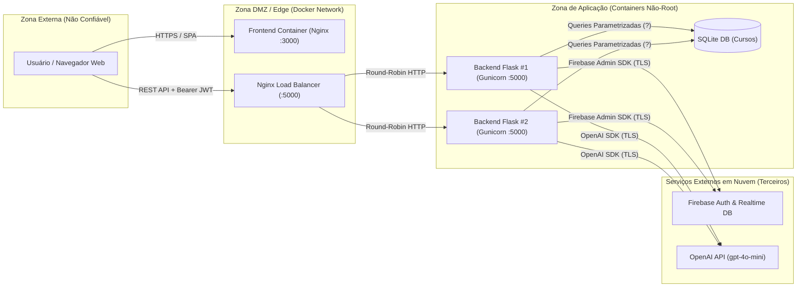
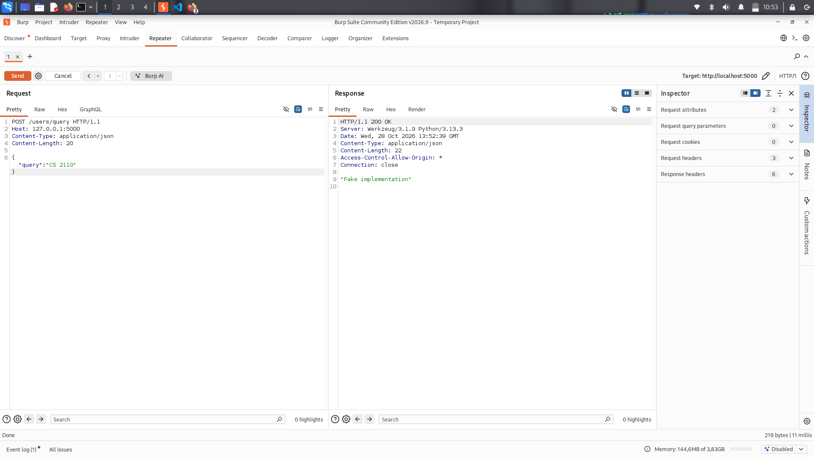
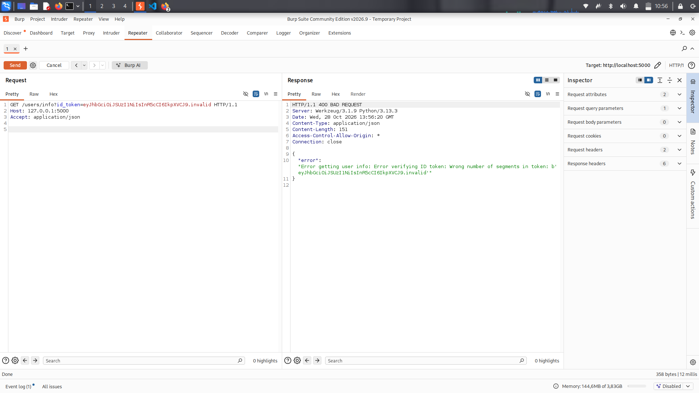
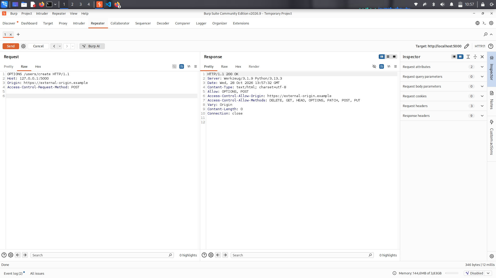
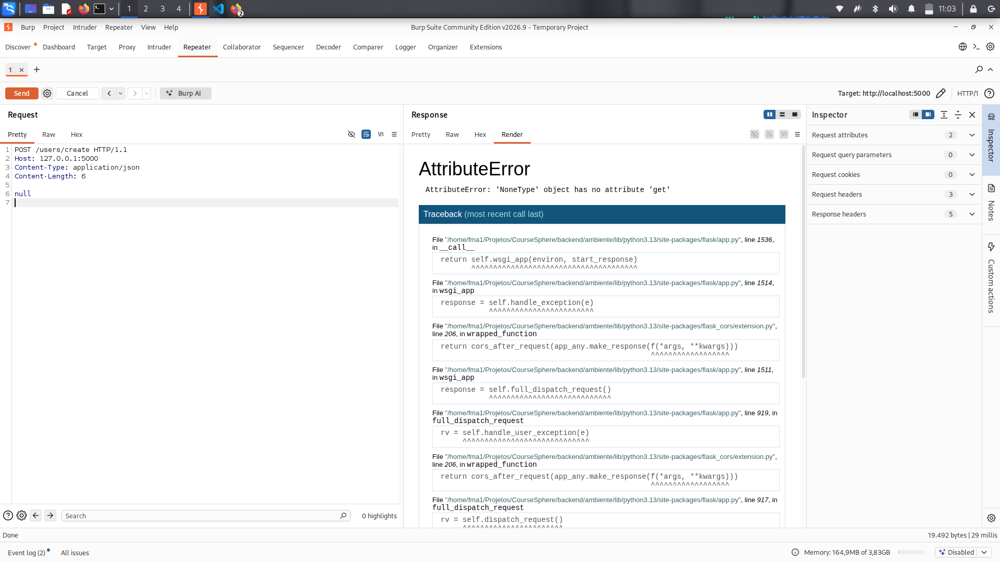
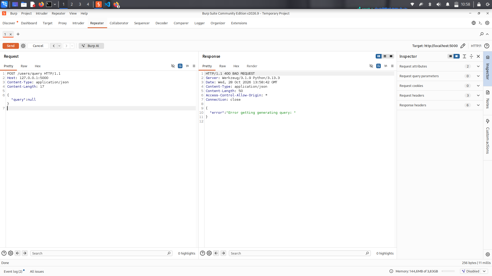
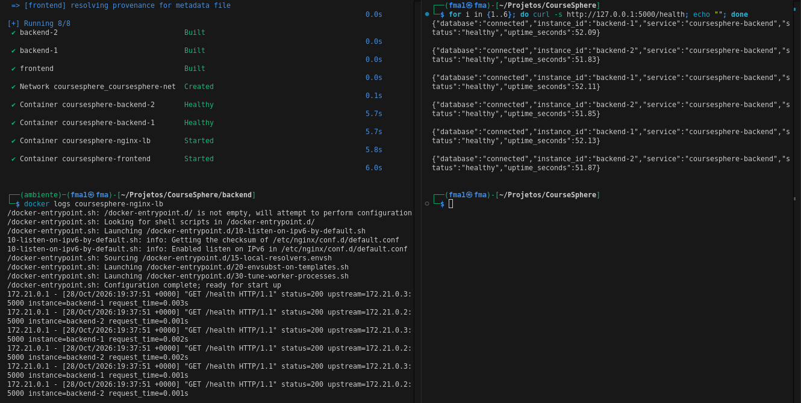
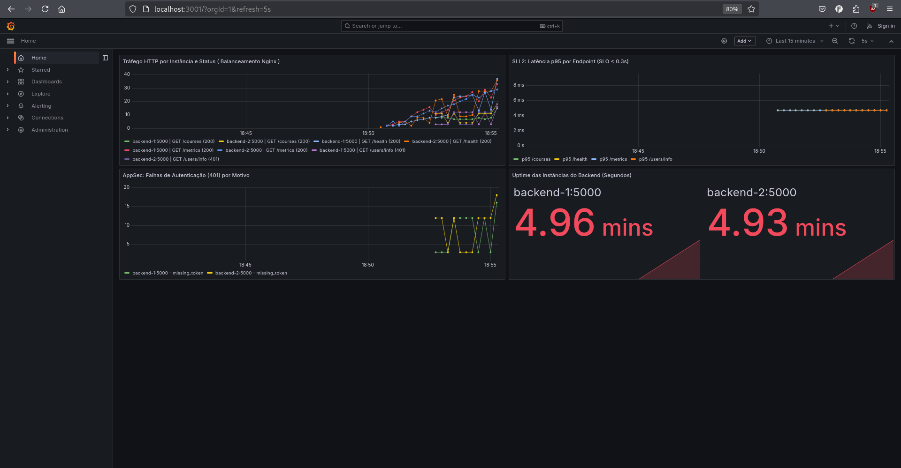

# Relatório Técnico — Segurança de Aplicações (AppSec) e Confiabilidade (SRE)
**Aplicação Alvo:** CourseSphere (Plataforma Web de Recomendação e Consulta Acadêmica de Cursos)  
**Stack Analisada:** Backend Python (Flask + SQLite + Firebase Admin + OpenAI SDK) | Frontend React (TypeScript + Vite) | Infraestrutura Docker + Nginx Load Balancer

---

## 1. Sumário Executivo (Visão para Gestão e Negócio)

Este relatório apresenta os resultados da avaliação de **Segurança de Aplicações (AppSec)** e **Engenharia de Confiabilidade (SRE)** realizada sobre a aplicação **CourseSphere**. O objetivo do trabalho foi identificar falhas reais de segurança que pudessem comprometer a confidencialidade, integridade e disponibilidade do sistema, corrigir a causa raiz das vulnerabilidades críticas, implementar controles adicionais de *hardening* e estruturar uma arquitetura containerizada, observável e escalável.

### Panorama de Risco (Antes vs. Depois)
Na versão inicial (*baseline*), a aplicação apresentava riscos severos ao negócio, incluindo:
- **Comprometimento de banco de dados (SQL Injection):** Qualquer usuário podia manipular consultas SQL nas rotas de cursos.
- **Risco financeiro direto (*Denial of Wallet*) e acesso não autorizado:** A rota de inteligência artificial (`/users/query`) processava chamadas sem exigir autenticação válida, permitindo que agentes externos consumissem créditos da API da OpenAI gratuitamente.
- **Risco de Execução Remota de Código (RCE) e Vazamento de Credenciais:** O servidor Flask rodava com o depurador interativo (`debug=True`) ativo, CORS irrestrito (`*`), tokens JWT trafegando na URL (ficando expostos em logs de acesso) e mensagens de exceção internas retornadas diretamente ao usuário final.

Após o ciclo de remediação, *hardening* e reengenharia SRE:
- **100% dos alertas de análise estática (SAST - Bandit)** no código da aplicação foram eliminados (redução de **20 alertas para 0**).
- **7 vulnerabilidades reais** foram documentadas com evidências práticas (SAST, SCA e capturas do *Burp Suite Community*) e corrigidas na causa raiz em commits atômicos.
- A aplicação foi instrumentada com **logs estruturados em JSON**, métricas **Prometheus (`/metrics`)**, verificação de saúde **(`/health`)**, **Rate Limiting**, **Headers de Segurança HTTP**, **Testes Automatizados de Segurança** e orquestrada via **Docker Compose com Balanceador de Carga Nginx** distribuindo tráfego entre **2 réplicas do backend**.

---

## 2. Escopo e Metodologia

### 2.1. Escopo da Avaliação
- **Backend (`backend/`):** API REST em Flask (`endpoints.py`), módulo de banco de dados SQLite (`db.py`, `blueprints/courses.py`), integração Firebase (`firebase.py`) e integração LLM/OpenAI (`main.py`, `query_manager.py`).
- **Frontend (`frontend/`):** Aplicação SPA em React 18 + TypeScript (`src/api.ts`, `src/pages/`, `src/components/`).
- **Infraestrutura:** `Dockerfile` (backend e frontend), balanceador de carga `nginx/nginx.conf` e orquestração `docker-compose.yml`.

### 2.2. Metodologia e Ferramentas Utilizadas
A avaliação combinou revisão manual de código e arquitetura (*White-Box Testing*) com ferramentas automatizadas alinhadas ao **OWASP Web Security Testing Guide (WSTG)**, **OWASP Top 10 (2021)** e **OWASP Top 10 for LLM Applications**:

| Categoria | Ferramenta | Finalidade | Evidência Gerada |
| :--- | :--- | :--- | :--- |
| **SAST (Backend)** | `Bandit` | Análise estática de segurança em código Python | [`docs/evidencias/bandit.txt`](./docs/evidencias/bandit.txt) (Antes) / [`bandit-pos-correcao.txt`](./docs/evidencias/bandit-pos-correcao.txt) (Depois) |
| **SAST (Frontend)** | `ESLint` + `eslint-plugin-security` | Detecção de padrões inseguros em TypeScript/React | [`docs/evidencias/eslint-security.txt`](./docs/evidencias/eslint-security.txt) |
| **SCA (Backend)** | `pip-audit` | Auditoria de CVEs em pacotes Python | [`docs/evidencias/pip-audit`](./docs/evidencias/pip-audit) |
| **SCA (Frontend)** | `npm audit` | Auditoria de CVEs na árvore `node_modules` | [`docs/evidencias/npm-audit`](./docs/evidencias/npm-audit) |
| **DAST / Proxy HTTP** | `Burp Suite Community` | Inspeção manual de requisições/respostas HTTP e cabeçalhos | [`docs/evidencias/prints/`](./docs/evidencias/prints/) e [`INDICE_EVIDENCIAS.md`](./docs/evidencias/INDICE_EVIDENCIAS.md) |

---

## 3. Modelagem de Ameaças — Threat Modeling (STRIDE)

### 3.1. Diagrama de Fluxo de Dados (DFD) e Fronteiras de Confiança



### 3.2. Matriz STRIDE

| Ameaça (STRIDE) | Vetor Identificado no CourseSphere | Mitigação / Controle Implementado |
| :--- | :--- | :--- |
| **S — Spoofing (Falsificação de Identidade)** | Rotas aceitando requisições sem validação de token JWT (`/users/query`) ou com CORS aberto (`*`). | Decorator `@require_auth` validando assinatura criptográfica do JWT via Firebase Admin SDK no header `Authorization: Bearer` e allowlist estrita de CORS. |
| **T — Tampering (Adulteração de Dados)** | Interpolação direta de strings em queries SQL (`/courses/<semester>`) e manipulação de caminhos no Firebase (`chat_id`). | Consultas SQL parametrizadas (`?`) no SQLite e validação por expressão regular (`^[A-Za-z0-9_-]{1,64}$`) para identificadores. |
| **R — Repudiation (Repúdio)** | Ausência de logs estruturados registrando quem executou ações ou falhas de autenticação. | Logging estruturado em JSON (`observability.py`) gravando `timestamp`, `client_ip`, `user_uid`, `method`, `path` e eventos `auth_failure`. |
| **I — Information Disclosure (Vazamento de Informação)** | Token JWT exposto na URL (`GET /users/info?id_token=...`), retorno de `str(e)` no JSON e Werkzeug Debugger ativo (`debug=True`). | Migração do JWT para o header `Authorization`, mensagens de erro sanitizadas ao cliente e desativação de `debug=True` por padrão. |
| **D — Denial of Service (Negação de Serviço / Carteira)** | Ausência de limite de requisições em `/users/create` e `/users/query` (exaustão de cota da OpenAI). | Rate Limiter *sliding-window* por IP/rota (`429 Too Many Requests`), limite de payload de 64 KB e balanceamento entre 2 réplicas com Nginx. |
| **E — Elevation of Privilege (Elevação de Privilégio)** | Execução de código via console Werkzeug (`debug=True`), container rodando como `root` e *Prompt Injection* no LLM. | Desativação do debugger, execução do container com usuário `appuser` (UID 10001) e isolamento da entrada do usuário com delimitadores `<user_query>`. |

---

## 4. Análise Detalhada das Vulnerabilidades e Correções Aplicadas

### Resumo e Matriz de Priorização de Correção

A priorização abaixo foi definida cruzando a **Severidade Técnica (CVSS v3.1)**, a **Facilidade de Exploração** e o **Impacto ao Negócio**:

| Ordem | ID | Vulnerabilidade | Categoria OWASP | Severidade (CVSS) | Status | Commit da Correção |
| :---: | :--- | :--- | :--- | :---: | :---: | :--- |
| **1º** | **VULN-01** | SQL Injection nas rotas de cursos | A03:2021 – Injection (CWE-89) | **Crítica (9.8)** | ✅ Corrigida | `6827b32` |
| **2º** | **VULN-02** | Quebra de Autenticação em `/users/query` (*Denial of Wallet*) | A01 / A07:2021 – Auth Failures | **Alta (8.2)** | ✅ Corrigida | `16f1c11` |
| **3º** | **VULN-04** | Flask `debug=True` (Werkzeug RCE) e CORS Irrestrito (`*`) | A05:2021 – Misconfiguration (CWE-94) | **Alta (7.8)** | ✅ Corrigida | `8588ba2` |
| **4º** | **VULN-03** | Exposição de Token JWT na URL e Vazamento de Exceções (`str(e)`) | A02 / A05:2021 – Info Disclosure | **Alta (7.5)** | ✅ Corrigida | `16f1c11` / `8588ba2` |
| **5º** | **VULN-06** | Prompt Injection e Validação com `assert` (CWE-703) | A03 / A04:2021 – Insecure Design | **Média (6.8)** | ✅ Corrigida | `16f1c11` / `23cb660` |
| **6º** | **VULN-05** | PRNG Criptograficamente Inseguro (`random`) e Segredos Fixos | A02:2021 – Crypto Failures (CWE-330) | **Média (6.2)** | ✅ Corrigida | `9ed96ad` |
| **7º** | **VULN-07** | Dependências Vulneráveis, Node 16 EOL, Object Injection e Senha Visível | A06:2021 – Vulnerable Components | **Média (5.8)** | ✅ Corrigida | `9ed96ad` / `3b8d9d5` |

> **Justificativa de Priorização:** Vulnerabilidades que permitem comprometimento imediato de dados/servidor sem autenticação (**VULN-01 SQLi**, **VULN-02 Consumo anônimo de API paga** e **VULN-04 Debugger RCE/CORS**) devem ser mitigadas no Dia 0 (Prioridade P0/P1), seguidas pela proteção de credenciais em trânsito (**VULN-03**) e fortalecimento criptográfico e de componentes (**VULN-05 a VULN-07**).

---

### 4.1. [VULN-01] SQL Injection nas Rotas de Cursos
- **Classificação:** OWASP A03:2021 (Injection) | CWE-89 | **Severidade: Crítica (CVSS 9.8)**
- **Localização:** `backend/blueprints/courses.py` (linhas 30, 47, 64, 80, 96, 112) e `backend/db.py`.
- **Descrição:** As consultas SQL eram construídas interpolando diretamente variáveis da URL usando *f-strings* do Python:
  ```python
  courses = execute_query(f"SELECT * FROM courses WHERE department = '{department}'").fetchall()
  ```
- **Passos de Reprodução e Evidência:**
  1. Executar o scanner estático Bandit (`bandit -r backend/`), que reporta 6 ocorrências `B608:hardcoded_sql_expressions` em `courses.py` (ver [`docs/evidencias/bandit.txt`](./docs/evidencias/bandit.txt) linhas 4–62).
  2. Enviar uma requisição `GET /courses/department/CS' OR '1'='1` altera a lógica booleana da cláusula `WHERE`, retornando todos os registros da tabela.
- **Impacto de Negócio:** Leitura não autorizada de todas as tabelas do banco SQLite (`UNION SELECT`), contorno de filtros e potencial corrupção de dados acadêmicos.
- **Causa Raiz e Solução Aplicada (Commit `6827b32`):**
  - *Causa Raiz:* Mistura entre comando SQL e dados não confiáveis do usuário na mesma string textual antes do parsing pelo banco.
  - *Por que a solução resolve a causa raiz:* A função `execute_query(query, params)` em `backend/db.py` foi refatorada para usar **Prepared Statements** (`cursor.execute("SELECT * FROM courses WHERE department = ?", (department,))`). O motor SQLite compila a estrutura da query separadamente e trata o parâmetro estritamente como literal, neutralizando qualquer metacaractere SQL.

---

### 4.2. [VULN-02] Quebra de Autenticação na Rota `/users/query`
- **Classificação:** OWASP A01:2021 (Broken Access Control) & A07:2021 (Identification and Authentication Failures) | **Severidade: Alta (CVSS 8.2)**
- **Localização:** `backend/endpoints.py` (linhas 65–72), `backend/firebase.py` (linhas 58–62) e `frontend/src/api.ts` (linha 184).
- **Descrição:** A rota `POST /users/query` chamava `Firebase.try_get_user_info()`, que capturava qualquer erro de validação de token e retornava `None`, prosseguindo normalmente com a chamada ao `QueryManager` (OpenAI). Além disso, no frontend (`api.ts`), `user?.getIdToken()` era chamado sem `await`, enviando uma `Promise` não resolvida.
- **Passos de Reprodução e Evidência:**
  1. Enviar no *Burp Suite Repeater* uma requisição `POST /users/query` sem nenhum cabeçalho `Authorization` e com corpo `{"query": "CS 2110"}`.
  2. A aplicação responde `HTTP/1.1 200 OK` (ver captura abaixo e [`docs/evidencias/http-requests-responses.txt`](./docs/evidencias/http-requests-responses.txt)).



- **Impacto de Negócio:** Qualquer usuário ou bot na internet pode consumir a integração com a OpenAI sem possuir conta no sistema, gerando exaustão financeira da chave de API (*Denial of Wallet*).
- **Causa Raiz e Solução Aplicada (Commit `16f1c11`):**
  - *Causa Raiz:* Ausência de um *gatekeeper* obrigatório de autenticação na rota `/users/query` e falha assíncrona na obtenção do token no cliente.
  - *Por que a solução resolve a causa raiz:* Foi criado o decorator `@require_auth` em `backend/endpoints.py`, exigindo e validando criptograficamente o token JWT no cabeçalho `Authorization: Bearer <token>` antes da execução da rota (retornando `401 Unauthorized` imediato caso ausente ou inválido), além da adição do `await` em `frontend/src/api.ts`.

---

### 4.3. [VULN-03] Exposição de Token JWT na URL e Vazamento de Exceções Internas (`str(e)`)
- **Classificação:** OWASP A02:2021 (Cryptographic Failures) & A05:2021 (Security Misconfiguration) | **Severidade: Alta (CVSS 7.5)**
- **Localização:** `backend/endpoints.py` (linhas 55–63 e todos os blocos `except`) e `frontend/src/api.ts` (linha 91).
- **Descrição:** A rota `GET /users/info?id_token=${idToken}` transmitia o token JWT de sessão diretamente na *query string* da URL. Paralelamente, todas as rotas retornavam `str(e)` na resposta JSON quando ocorria uma exceção.
- **Passos de Reprodução e Evidência:**
  1. Enviar `GET /users/info?id_token=eyJhbGciOiJSUzI1NiIsInR5cCI6IkpXVCJ9.invalid` via *Burp Suite Repeater*.
  2. O token fica gravado na linha de requisição HTTP (e nos logs de acesso do servidor), e a resposta `400 BAD REQUEST` vaza a mensagem interna da biblioteca `firebase_admin` (`Error verifying ID token: Wrong number of segments in token...`).



- **Impacto de Negócio:** Sequestro de sessão (*Session Hijacking*) por meio de tokens vazados em logs de proxy/histórico do navegador/cabeçalho `Referer` e reconhecimento da arquitetura interna por atacantes através das mensagens de exceção.
- **Causa Raiz e Solução Aplicada (Commits `16f1c11` e `8588ba2`):**
  - *Causa Raiz:* Transporte de credencial em parâmetro de URL (em vez de cabeçalho HTTP) e acoplamento direto entre a mensagem interna da exceção Python (`str(e)`) e a resposta enviada ao cliente.
  - *Por que a solução resolve a causa raiz:* O endpoint `GET /users/info` e o cliente `api.ts` foram refatorados para aceitar tokens **exclusivamente** via cabeçalho `Authorization: Bearer <token>`. Os blocos `except` passaram a registrar o erro detalhado apenas no logger estruturado interno (`logger.error`), retornando mensagens padronizadas e genéricas ao cliente.

---

### 4.4. [VULN-04] Configuração Incorreta: `debug=True`, CORS Irrestrito e Ausência de Headers de Segurança
- **Classificação:** OWASP A05:2021 (Security Misconfiguration) | CWE-94 | **Severidade: Alta (CVSS 7.8)**
- **Localização:** `backend/endpoints.py` (linhas 8, 18–20 e 108).
- **Descrição:**
  1. `CORS(app)` permitia qualquer origem externa (`Access-Control-Allow-Origin: *` ou reflexão da `Origin`).
  2. `app.run(debug=True)` ativava o depurador interativo do Werkzeug em produção (detectado pelo Bandit como `B201:flask_debug_true` de severidade Alta).
  3. As respostas HTTP não incluíam nenhum cabeçalho de segurança (`CSP`, `HSTS`, `X-Frame-Options`, `X-Content-Type-Options`).
- **Passos de Reprodução e Evidência:**
  1. Enviar `OPTIONS /users/create` com `Origin: https://external-origin.example` confirma a reflexão da origem externa e a falta de Security Headers (Print 03).
  2. Enviar `POST /users/create` com body `null` dispara um `AttributeError` não tratado e renderiza o traceback completo do **Werkzeug Debugger** expondo caminhos e código-fonte do servidor (Print 05).





- **Impacto de Negócio:** Exposição do código-fonte interno, risco de Execução Remota de Código (RCE) pelo console interativo do Werkzeug, ataques de *Clickjacking* e requisições cross-origin não autorizadas.
- **Causa Raiz e Solução Aplicada (Commits `8588ba2` e `23cb660`):**
  - *Causa Raiz:* Configurações de desenvolvimento codificadas de forma fixa (*hardcoded*) no código de inicialização e ausência de política de cabeçalhos de segurança.
  - *Por que a solução resolve a causa raiz:* O modo debug passou a ser controlado via variável de ambiente com padrão seguro `FLASK_DEBUG=false` (e substituído pelo servidor WSGI `gunicorn` no container Docker). O `CORS` foi restrito a uma *allowlist* explícita (`CORS_ALLOWED_ORIGINS`) e o hook `@app.after_request` aplica automaticamente todos os cabeçalhos de segurança HTTP.

---

### 4.5. [VULN-05] Uso de Gerador Pseudo-Aleatório Inseguro (`random`) e Segredos Fixos em Arquivos
- **Classificação:** OWASP A02:2021 (Cryptographic Failures) | CWE-330 | **Severidade: Média (CVSS 6.2)**
- **Localização:** `backend/main.py` (linhas 9–22) e `backend/firebase.py` (linha 4).
- **Descrição:** A função `hashFunction` utilizava o módulo `random` padrão (*Mersenne Twister*) e `numpy.random.poisson` para gerar valores de salt e embaralhamento na rota `/hash` (3 alertas `B311` no Bandit). Além disso, chaves da OpenAI e do Firebase dependiam exclusivamente de arquivos locais fixos (`./config.json` e `./credentials.json`).
- **Evidência:** [`docs/evidencias/bandit.txt`](./docs/evidencias/bandit.txt) (linhas 169–197).
- **Causa Raiz e Solução Aplicada (Commit `9ed96ad`):**
  - *Causa Raiz:* Uso de PRNG estatístico (cujo estado interno é determinístico e previsível) em contexto de segurança e acoplamento de segredos a arquivos locais.
  - *Por que a solução resolve a causa raiz:* O módulo `random`/`numpy` foi substituído por `secrets.SystemRandom()`, `secrets.choice()` e `secrets.randbelow()` (CSPRNG alimentado pelo `os.urandom` do sistema operacional), e o carregamento de credenciais foi migrado para variáveis de ambiente (`OPENAI_API_KEY`, `FIREBASE_CREDENTIALS_JSON`, `FIREBASE_DATABASE_URL`).

---

### 4.6. [VULN-06] Uso de `assert` para Validação de Input e Vetor de Prompt Injection
- **Classificação:** OWASP A03:2021 / A04:2021 (Insecure Design) | CWE-703 | **Severidade: Média (CVSS 6.8)**
- **Localização:** `backend/query_manager.py` (linhas 44 e 68).
- **Descrição:** O construtor `QueryManager.__init__` usava `assert (query is not None)` para validar o input do usuário (alerta `B101` do Bandit) e concatenava `self.query` diretamente no meio do prompt de instrução da OpenAI sem delimitadores nem limite de tamanho.
- **Passos de Reprodução e Evidência:**
  1. Enviar `POST /users/query` com `{"query": null}` dispara um `AssertionError` vazio (Print 04 abaixo e [`bandit.txt`](./docs/evidencias/bandit.txt) linhas 199–207).



- **Causa Raiz e Solução Aplicada (Commits `16f1c11` e `23cb660`):**
  - *Causa Raiz:* Uso de `assert` (que é ignorado pelo Python quando executado com `python -O`) em vez de validação estruturada de entrada, e falta de separação entre dados do usuário e instruções do modelo LLM.
  - *Por que a solução resolve a causa raiz:* O `assert` foi substituído por verificação explícita de tipo, tamanho máximo (500 caracteres) e sanitização via `sanitize_text()`, além de isolar a entrada do usuário dentro de tags delimitadoras `<user_query>...</user_query>`.

---

### 4.7. [VULN-07] Componentes Vulneráveis, Node 16 EOL, Object Injection e Senha Visível no SignUp
- **Classificação:** OWASP A06:2021 (Vulnerable and Outdated Components) & A04:2021 | **Severidade: Média (CVSS 5.8)**
- **Localização:** `frontend/Dockerfile` (linha 2), `frontend/src/components/DeckOfCards/CardDeck.tsx` (linha 31) e `frontend/src/pages/signup/SignUp.tsx` (linha 44).
- **Descrição e Evidências:**
  1. O `frontend/Dockerfile` usava `FROM node:16-alpine` (versão com suporte encerrado em 2023) rodando como `root`.
  2. O `eslint-plugin-security` identificou `security/detect-object-injection` em `CardDeck.tsx:31` ([`docs/evidencias/eslint-security.txt`](./docs/evidencias/eslint-security.txt)).
  3. O `npm audit` reportou 39 vulnerabilidades nas dependências ([`docs/evidencias/npm-audit`](./docs/evidencias/npm-audit)) e o `pip-audit` identificou 12 vulnerabilidades no `pip` ([`docs/evidencias/pip-audit`](./docs/evidencias/pip-audit)).
  4. O campo de senha em `SignUp.tsx` não possuía `type="password"`, exibindo a senha em texto claro durante a digitação.
- **Causa Raiz e Solução Aplicada (Commits `9ed96ad` e `3b8d9d5`):**
  - *Solução:* Atualização do `frontend/Dockerfile` para build multi-stage com `node:20-alpine` e `nginx:1.27-alpine`, substituição do acesso `cards[currentIndex]` por `cards.at(currentIndex)` com verificação de nulidade em `CardDeck.tsx` e adição de `type="password"` em `SignUp.tsx`.

---

## 5. Hardening Básico e Verificação Automatizada (DevSecOps)

Além das correções diretas, foram implementadas três camadas extras de *hardening* no módulo [`backend/security.py`](./backend/security.py):

1. **Rate Limiting por IP e Rota (`SlidingWindowRateLimiter`):**
   - Limita requisições por endereço IP em janela deslizante, respondendo `HTTP 429 Too Many Requests` com cabeçalhos `Retry-After`, `X-RateLimit-Limit` e `X-RateLimit-Remaining`:
     - `POST /users/create`: **5 req/min** (mitigação contra abuso de criação de contas).
     - `POST /users/query`: **15 req/min** (proteção de cota da API OpenAI).
     - Demais rotas autenticadas: **20 a 30 req/min**.
2. **Headers de Segurança HTTP (`apply_security_headers`):**
   - Aplicados em todas as respostas da API via `@app.after_request`:
     - `X-Content-Type-Options: nosniff`
     - `X-Frame-Options: DENY`
     - `Strict-Transport-Security: max-age=31536000; includeSubDomains`
     - `Content-Security-Policy: default-src 'self'; frame-ancestors 'none'; base-uri 'self'`
     - `Referrer-Policy: strict-origin-when-cross-origin`
     - `Permissions-Policy: geolocation=(), microphone=(), camera=()`
3. **Sanitização e Validação Estrita de Entradas:**
   - Limite de 64 KB para payloads JSON (`MAX_CONTENT_LENGTH`), validação de formato de e-mail e tamanho de senha (8–128 caracteres), escape de entidades HTML (`html.escape`) e validação regex (`^[A-Za-z0-9_-]{1,64}$`) em `chat_id` contra *Path Traversal* no Firebase Realtime Database.
4. **Pipeline CI/CD Automatizada (`.github/workflows/secops-ci.yml`):**
   - Executa automaticamente em cada `push`/`pull_request` o Bandit (SAST), ESLint Security, `pip-audit`, `npm audit` e a suíte de 7 testes automatizados de segurança (`backend/tests/test_security.py`).

---

## 6. Engenharia de Confiabilidade (SRE), Observabilidade e Escalabilidade

### 6.1. Containerização e Balanceamento de Carga (Nginx + 2 Réplicas do Backend)
A aplicação foi containerizada e orquestrada via [`docker-compose.yml`](./docker-compose.yml) com:
- **2 instâncias independentes do backend (`backend-1` e `backend-2`):** Executando com servidor WSGI de produção (`gunicorn`), usuário não-root (`appuser`) e `HEALTHCHECK` ativo no endpoint `/health`.
- **Balanceador de Carga Nginx (`nginx-lb`):** Distribuindo as requisições em algoritmo *round-robin* entre `backend-1:5000` e `backend-2:5000`, com tolerância a falhas (`max_fails=3 fail_timeout=10s`).



### 6.2. Instrumentação de Observabilidade (Logs Estruturados + Métricas Prometheus)
No módulo [`backend/observability.py`](./backend/observability.py):
- **Logs Estruturados em JSON:** Cada requisição HTTP, erro interno e falha de autenticação emite um objeto JSON em linha única contendo `timestamp`, `level`, `service`, `instance_id`, `event`, `method`, `path`, `status_code`, `duration_ms`, `client_ip` e `user_uid`.
- **Endpoint `/health`:** Valida a conectividade ativa com o banco SQLite (`SELECT 1`) e retorna status `200 OK` (`healthy`) ou `503 Service Unavailable` (`degraded`).
- **Endpoint `/metrics`:** Expõe métricas compatíveis com **Prometheus**:
  - `http_requests_total{method, endpoint, status, instance}`
  - `http_errors_5xx_total{endpoint, instance}`
  - `http_request_duration_seconds_bucket{endpoint, instance, le}`
  - `auth_failures_total{reason, instance}`
  - `process_uptime_seconds{instance}`

### 6.3. Definição de SLIs e SLOs

| Indicador (SLI) | Definição Técnica e Fórmula PromQL | Objetivo de Nível de Serviço (SLO) | Error Budget (30 dias) |
| :--- | :--- | :--- | :--- |
| **SLI 1 — Disponibilidade (Taxa de Sucesso HTTP)** | Proporção de requisições HTTP atendidas sem erro interno de servidor (`status < 500`):<br>`1 - (sum(rate(http_errors_5xx_total[5m])) / sum(rate(http_requests_total[5m])))` | **$\ge 99.5\%$** das requisições bem-sucedidas em janela móvel de 30 dias. | **$0.5\%$** (~3h 36min de indisponibilidade máxima mensal). |
| **SLI 2 — Latência de Resposta da API (p95)** | Tempo de resposta no percentil 95 (`p95`) das rotas da API (`/courses`, `/users/info`, `/health`):<br>`histogram_quantile(0.95, sum(rate(http_request_duration_seconds_bucket[5m])) by (le, endpoint))` | **$p95 < 300\text{ ms}$** durante $99\%$ das janelas de medição de 5 minutos. | Máximo de $1\%$ das janelas de 5 min acima de $300\text{ ms}$. |

### 6.4. Especificação do Dashboard de Observabilidade (Grafana + Prometheus)
Para visualização contínua em operação (baseada nos *Four Golden Signals* do Google SRE), o dashboard no **Grafana** conectado à fonte de dados do Prometheus é estruturado em 4 linhas de painéis:
1. **Painel 1 — cumprimento de SLOs e Disponibilidade (Stat / Gauge):**
   - Exibe a porcentagem de disponibilidade atual (`SLI 1`) comparada ao alvo de `99.5%` e o status do `/health` de `backend-1` e `backend-2`.
2. **Painel 2 — Tráfego e Distribuição de Carga por Instância (Time Series):**
   - Query: `sum(rate(http_requests_total[1m])) by (instance, status)` — permite visualizar em tempo real o balanceamento equitativo de carga pelo Nginx entre `backend-1` e `backend-2`.
3. **Painel 3 — Latência p50, p95 e p99 por Rota (Time Series com Threshold em 300ms):**
   - Query: `histogram_quantile(0.95, sum(rate(http_request_duration_seconds_bucket[5m])) by (le, endpoint))` — dispara alerta visual caso a linha ultrapasse o SLO de `0.3s`.
4. **Painel 4 — Monitoramento de Segurança AppSec (Falhas de Autenticação e Rate Limit):**
   - Query: `sum(rate(auth_failures_total[5m])) by (reason)` e `sum(rate(http_requests_total{status="429"}[5m]))` — detecta ataques de força bruta, varredura de tokens inválidos ou abuso de API em tempo real.



### 6.5. Principais Riscos de Disponibilidade Identificados e Recomendações de Resiliência
1. **Banco de Dados SQLite Local em Múltiplas Instâncias:**
   - *Risco:* O SQLite é um banco embarcado em arquivo local; em escritas concorrentes ou múltiplos containers sem volume compartilhado/SGBD externo, há risco de *database lock* ou divergência de estado.
   - *Recomendação:* Migrar o catálogo de cursos para uma instância gerenciada de **PostgreSQL** (ex.: Cloud SQL / RDS) com *connection pooling* (`PgBouncer`).
2. **Estado do Rate Limiter em Memória Local:**
   - *Risco:* Como o `SlidingWindowRateLimiter` armazena contadores na memória de cada processo Gunicorn, com 2 réplicas atrás do Nginx um cliente pode fazer o dobro de requisições antes de ser bloqueado.
   - *Recomendação:* Centralizar os contadores de Rate Limiting em um cluster **Redis** compartilhado pelas réplicas.
3. **Dependência Síncrona de APIs Externas (OpenAI e Firebase):**
   - *Risco:* Se a API da OpenAI apresentar alta latência ou queda, os workers do Gunicorn podem ficar bloqueados aguardando resposta (*Thread Exhaustion*).
   - *Recomendação:* Aplicar **Timeouts explícitos** (ex.: 5s), política de **Retry com Exponential Backoff + Jitter** e padrão **Circuit Breaker** nas chamadas ao SDK da OpenAI e Firebase.

